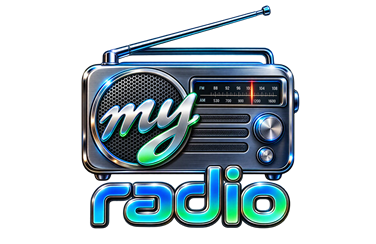
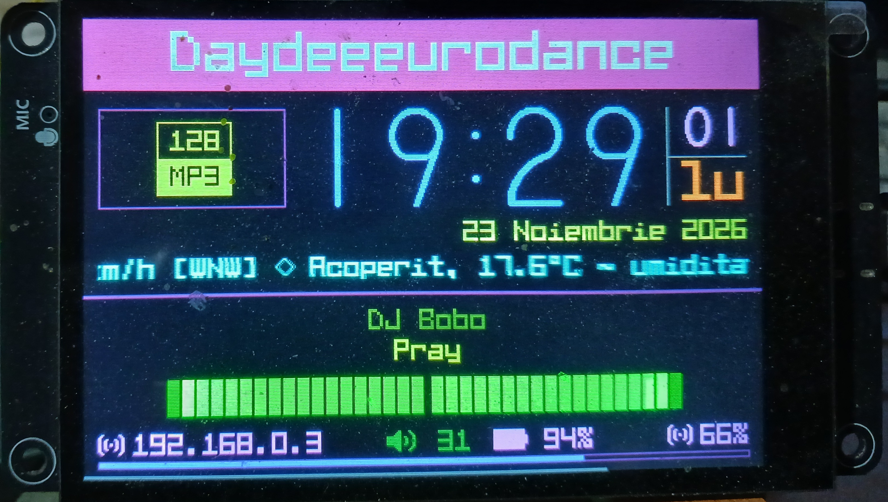
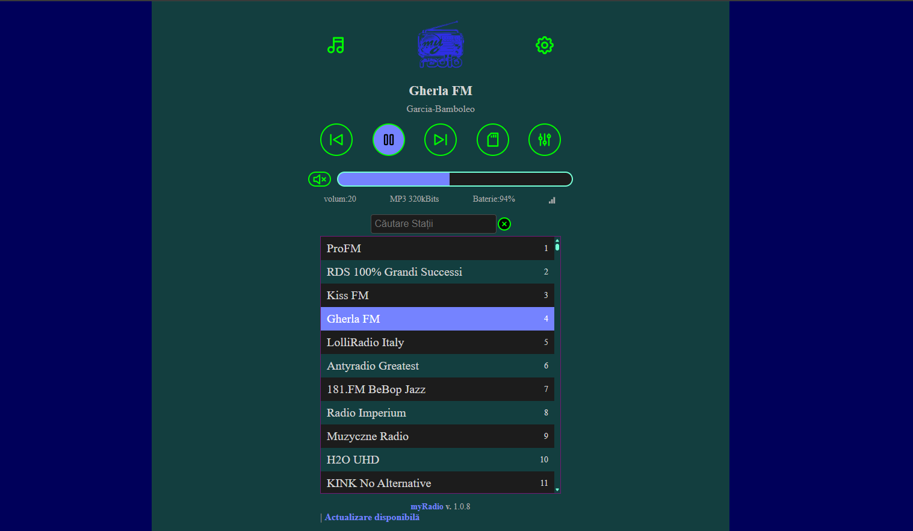

# myRadio

***This documentation is the same on the [Github Page](https://death-kiss78.github.io/myRadio/), which may be easier to read.***

## Introduction

myRadio runs on an ESP32-S3 to play Internet radio streams and may be built using an ESP32-S3, an audio decoder, a display, and some inputs.
PSRAM is required so WROVER boards are not supported.
In some cases, like for the ES3C28P, no peripherals are even needed.

To develop and compile use [VS Code](https://code.visualstudio.com/) and [Platformio](https://platformio.org/) but you may try other IDEs.

Some libraries may only be available from [Platformio Registry](https://registry.platformio.org/).

---

## Project Heritage,  New Branding & Project Identity

myRadio continues a long community-driven project lineage:

yoRadio ( [e2002](https://github.com/e2002) )
   ↓
ehRadio ( [Trip5](https://github.com/Trip5) )
   ↓
myRadio ( [death-kiss78](https://github.com/death-kiss78) )

While myRadio introduces its own branding, features, visual identity and improvements, it would not exist without the foundations laid by e2002 and the substantial development work carried out by Trip5.

On November 15, 2026, myRadio officially adopted its new visual identity.
The project branding was redesigned to better reflect its international and community-driven nature, replacing project-specific national symbolism with a neutral, project-focused identity across the firmware, WebUI, documentation, boot screens and release infrastructure.
This transition represents an important milestone in the project's evolution. While respecting and acknowledging its heritage, myRadio now moves forward under its own identity and direction.

Special thanks to e2002 for creating yoRadio and to Trip5 for the extensive development that transformed the project into ehRadio and inspired the creation of myRadio.

This marks the beginning of the myRadio community era.

---

## Features

myRadio is designed to be easy to use for everyday listeners while remaining flexible for builders, makers and developers.

Building upon the foundations of yoRadio and ehRadio, myRadio adds new features, improvements and refinements focused on stability, customization and long-term maintainability.

In addition to Internet radio streaming, myRadio can also play local audio files from an SD card, allowing it to function as both a network radio and a standalone audio player.

### For Users

  - [Web Flasher and Internet OTA Updates](https://death-kiss78.github.io/myRadio/flasher.html)
    - Make installing and updating myRadio quick and easy.
    - *Caveat:* your build must be available in the `builds` folder of this repository, or you can request support for your board
    - The best starting point, after reading this documentation, is the [myoptions Generator](https://death-kiss78.github.io/myRadio/myoptions/generator.html).

The generator helps to create a complete `myoptions.h` file, which should be placed in the project root alongside `platformio.ini` (which the generator can also create).
It includes support for most available hardware peripherals and build options supported by myRadio, together with notes and recommendations for common configurations.
The generator can create shareable configurations by encoding the generated JSON directly into the URL. Advanced options and custom notes can also be included, making it easy to share entire project configurations with other users.

## WebUI

The WebUI interface is optimized for mobile browsers but looks great on PCs, too.
With `37` display locales and `50` WebUI locales currently available,
myRadio is accessible to users all around the world.

## Hardware Choices

There are many considerations to make when building a radio.

For a detailed guide to supported hardware and peripherals, wiring, and audio isolation, read [here](Hardware.md).

---

## Radio Creations

If you already have a good idea on how the hardware works and would just like to use a prebuilt binary, check out the [Releases](https://death-kiss78.github.io/myRadio/releases/) and click on a link to open the generator with that binary's profile, which includes hardware needed, pins to connect, and more.
There is also a `no_display` build here if you just wish to test functionality.

Note that if following this path, you don't necessarily need to attach all peripherals (rotary, buttons, IR Receiver, SD card, display).
The radio needs only the ESP board and the audio decoder to function... although your WebUI may show links to peripherals that don't exist.

If you don't want to mess around with VS Code but would still like your own build added to the Releases, you can make a
[firmware request](https://death-kiss78.github.io/myRadio/discussions/categories/firmware-requests).
Please also do some research before requesting a firmware.

### Credit

Thanks to:

- https://github.com/Trip5 - creator and maintainer of ehRadio, introducing major improvements, hardware support, web interface enhancements and numerous features built upon the original yoRadio project

- https://github.com/death-kiss78 - ro_RO & it_IT translations, SDMMC testing, initiated SD File Manager, inspired screensaver info text & screensaver sleep, sleep command fixes, and creator/maintainer of myRadio

- https://github.com/kle7rx - ru_RU translation, debugging, mute functionality, VS1053/I2S fixing, amplifier schematics, SSD1327 fixes, SD1322 fixes, NV3007 support, OLED128x64 Minimal & Compact layouts, Default layouts for OLED256x64 & TFT428x142

- https://github.com/kasperaitis - lt_LT translation, initiating locales, battery support and widget, and a bunch of work for ES3C28P (including ES8311 decoder, FT6336 touchscreen)

- https://github.com/e2002 - creator of yoRadio, the project that laid the foundation for ehRadio and ultimately myRadio
